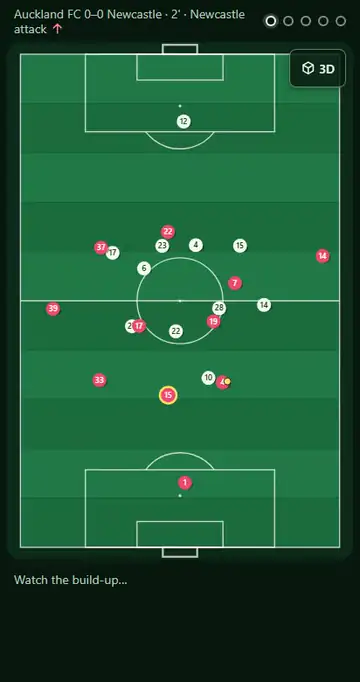
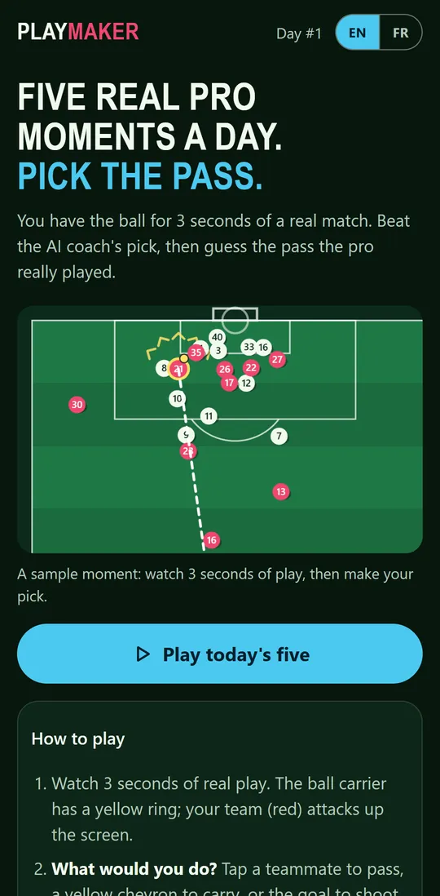
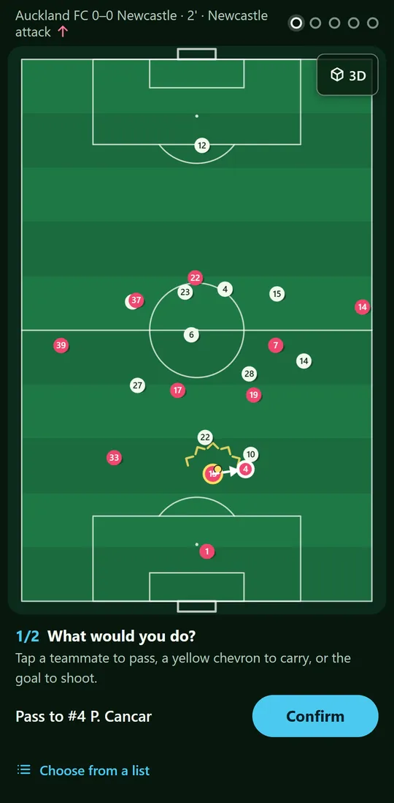
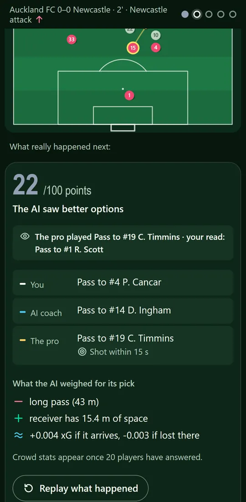
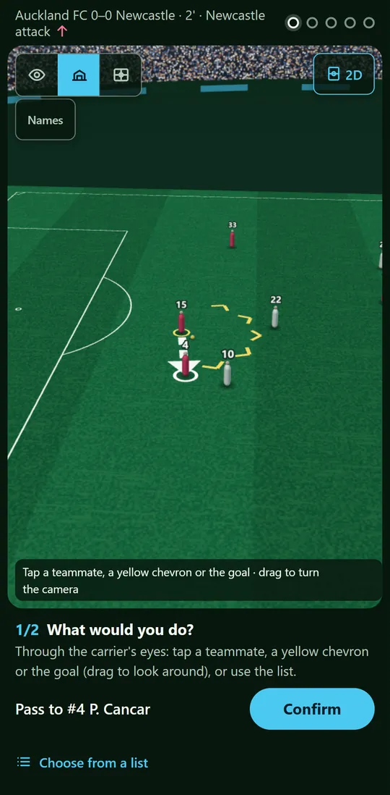
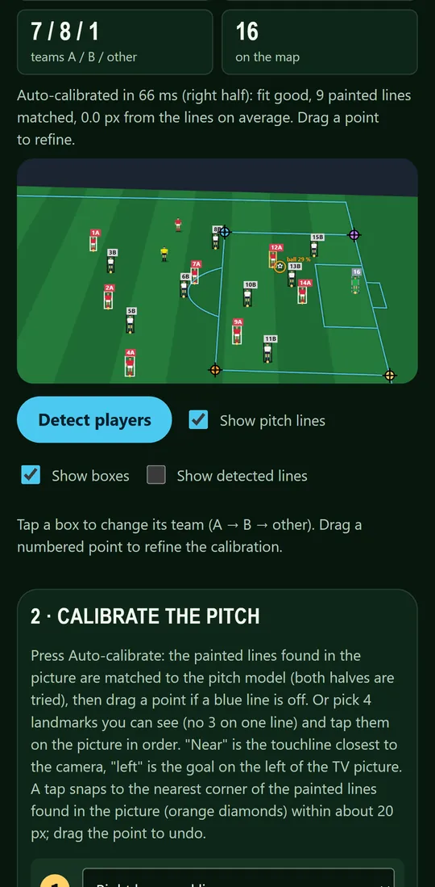
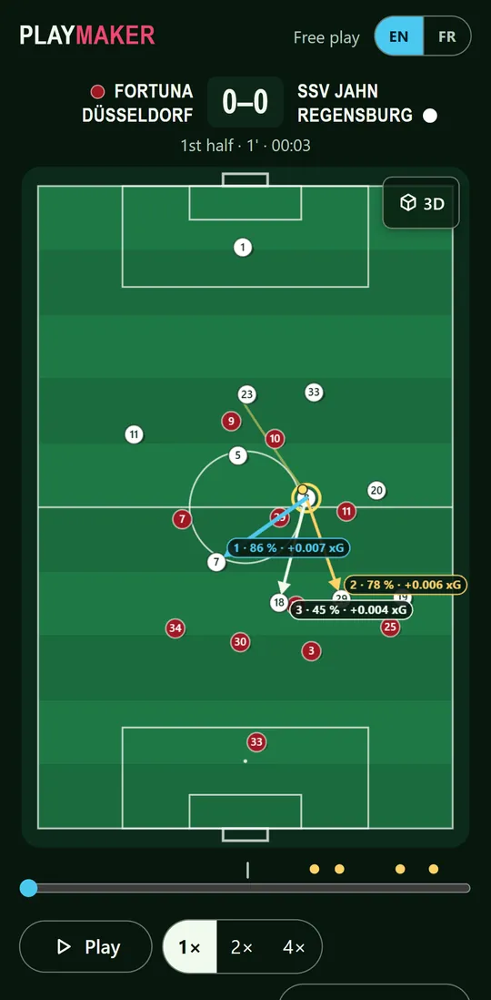

# Playmaker

**Play the demo: https://yandouziyassine.github.io/playmaker/** (static build: 30 days of content, picks scored in
your browser, no crowd stats; the full service keeps answers on a server, see docs/ARCHITECTURE.md).

A daily football decision game. Five real moments from professional matches: you have the ball, pick the pass. Then
see the AI coach's pick and its reasons, what the pro did, what happened in the next 15 seconds, and how other players
chose.

The AI coach, its data and its honest benchmark live in
[COMPUTER-VISION-PROJECT-LIBRARY / 20-football-analytics](https://github.com/yandouziyassine/COMPUTER-VISION-PROJECT-LIBRARY/tree/main/20-football-analytics)
(design: `docs/superpowers/specs/2026-11-09-playmaker-fan-game-design.md`).

**Docs:** [architecture](docs/ARCHITECTURE.md) · [case study](docs/CASE_STUDY.md) · [decisions](docs/DECISIONS.md)

## Screenshots

<p align="center"></p>

<table>
<tr>
<td align="center"><br><sub>Intro: a real moment loops as the preview</sub></td>
<td align="center"><br><sub>Choose: tap a teammate, a carry or the goal</sub></td>
<td align="center"><br><sub>Reveal: you, the AI coach, the pro, the reasons</sub></td>
</tr>
<tr>
<td align="center"><br><sub>3D: stadium camera (also player's eyes, tactical)</sub></td>
<td align="center"><br><sub>Lab: detection and auto-calibration (synthetic scene)</sub></td>
<td align="center"><br><sub>Free play: a full match, ask the coach any time</sub></td>
</tr>
</table>

All images are the app's own renders (Pixel 7 size, dev build, content of 2026-12-01; the Lab image is its code-drawn
synthetic scene, no broadcast picture). Regenerate them with `scripts/showcase/` (`shots.mjs`, `optimise.mjs`,
`clip.mjs`, and `og.mjs` for the 1200 x 630 social card `app/public/og.png`).

## What you play

- **Five real moments a day** from open professional tracking data (Bundesliga, 2. Bundesliga, A-League). Watch 3 s of
  real play, then two questions: **What would you do?** (scored by the AI coach, close calls get full points) and
  **What did the pro actually do?** (objective: the real pass).
- **The reveal**: your points, the AI's pick with what helped and hurt, the pro's pick, what happened next, the crowd
  split, every option's score on the pitch, and a replay of the real 6 seconds after the pass.
- **2D or 3D**: a lazy three.js view with three cameras (player's eyes from the carrier's head, a TV-style stadium
  camera, a high tactical view); the camera glides between modes and follows the ball with frame-rate independent
  smoothing. Tap teammates in either view.
- **Your stats** (by pitch zone and pick type, pro reads, an insight line), streaks, past days, a share image.
- **Lab: from a TV picture to tactics**: detect players and the ball in your own broadcast screenshot or a live phone
  camera, in the browser (MediaPipe EfficientDet-Lite0 by default, Lite2 as a more accurate option, both Apache-2.0),
  split teams by shirt colour, **calibrate the pitch automatically from its painted lines** (about 50-110 ms; or 4 taps
  snapped to line corners), see the shape from above, then ask the real AI coach for the carrier's best options.
- **Free play**: a full Bundesliga match from above (2D or 3D); pause any time and ask the coach.
- **Offline and bilingual**: a service worker keeps the app and today's five, answers given offline are scored when
  the network is back; English and French throughout.

## How it works

- **Content** is built offline by the library (`python -m coach.game.build`): every moment is scored by models trained
  without its match, plus 20 refits on resampled matches for the close-call rule. Public files carry no answers;
  answers stay server-side until you pick. A content audit (`python -m coach.game.evaluate_content`) checks that no
  trivial strategy (always shoot, most advanced pass, nearest teammate) beats the game: after the fix none reaches 100
  on any released moment (best 59 points vs 57 for playing like the pro).
- **API** (`api/`): `POST /api/pick` validates the pick and the pro guess, keeps the first answer per player and
  moment, rate-limits per network (salted hash, never the IP), and returns the reveal and the crowd split (from 20
  picks).
- **Game** (`app/`): Vite + TypeScript, canvas 2D, lazy three.js chunk for 3D, phone first; history in the browser.
- **Coach engine** (`app/src/coach/`): TypeScript port of the library's models, equal to Python within 1e-6
  (`app/test/coach-parity.test.ts`).
- **CV benchmark** (`scripts/cv-bench/`): broadcast-like frames rendered from **real tracking data** with a known
  camera, so the ground truth is exact. On 60 frames (1,133 players) the Lab's detector went from 43.5 % to 69.9 %
  person recall (80.1 % with the Lite2 option), precision 80.6 % to 85.9 % (94.0 %), small players (< 40 px) 28.8 % to
  61.9 % (73.4 %). Synthetic frames only: not measured on real TV pictures.
- **Static demo** (`npm run demo:build`, GitHub Pages): 30 days that cycle, the answer files shipped, picks scored in
  the browser with the API's own result code. Fine for a demo, not for the real game: anyone can read the answers.

## Run locally

```bash
npm install
npm run content:link -- <path to content-v1>
PLAYMAKER_TODAY=2026-12-01 npm run dev     # API + content on :8787
npm run dev:app                           # game on :5173
npm test && npm run e2e
```

**On your phone (same Wi-Fi):** run `npm run dev` and `npm run dev:phone`, then open the `https://<laptop-ip>:5173`
address Vite prints and accept the self-signed certificate once. The Lab's live camera needs this HTTPS address
(browsers only allow the camera on secure pages). Point the phone at the TV, freeze, tap 4 landmarks, resume.

## Data credits

Bundesliga tracking and event data: Bassek et al. (2025), DFL / Sportec Solutions, CC BY 4.0.
Tracking and event data: SkillCorner open data (MIT). Code: MIT.
